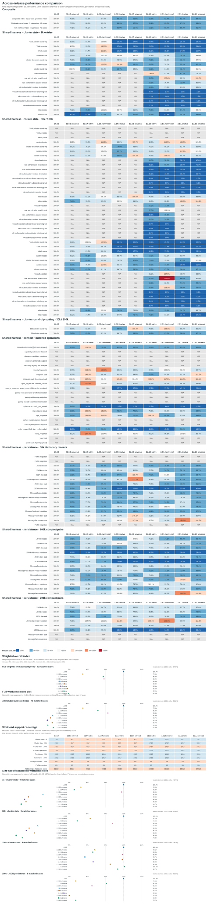

# Native and shared-harness performance baselines

**Historical measurements:** 18 October 2026<br>
**Runtime:** CPython 3.12.3, Linux x86_64, glibc 2.39<br>
**Packages:** 1.8.0.0, 1.9.0.1, 2.0.0.0, 2.0.0.2, 2.2.0.0, 2.2.0.1, and 2.2.0.3.

One consolidated diagram compares the earlier releases and both 2.2.0.4 builds.
It contains the composite index, cluster, persistence, and connect panels, plus
four size-specific matched-workload index panels.
Cells compare matching p50 measurements with 1.8.0.0; below 1× is faster. The
composite uses the geometric mean of matched case ratios, with cluster state,
persistence, and connect weighted equally. Within each suite, cases receive
equal weight. The index is unitless and lower is better; it is a summary of this
specific benchmark mix, not a prediction for every deployment workload.

The Composite section also reports a **full-workload index**: one geometric
mean across all 37 positive-p50 cases shared by every displayed release/build,
with each case weighted equally. It includes cluster-state cases at 1k, 30k,
and 100k, matched connect cases, and 200k JSON-persistence cases. This differs
from the adjacent composite, which first combines results within suites and
then weights the three suites equally. The full-workload index is still specific
to this benchmark mix and does not imply a universal winner. Focused 30k/100k
persistence cases are excluded because 2.2.0.3 was not measured there; YAML and
unsupported 200k MessagePack cases have no common positive-p50 result to score.
The full-workload index also has its own point-plot section below, using the
same release/build series and index values as the summary row above.

Only cases with measured results for every compared column contribute to the
composite. It uses cluster 1k and 30k/100k cases, connect cases, and 200k JSON
persistence cases; 200k MessagePack StateStore is unsupported by payload/array
limits. Focused 30k/100k persistence is omitted from the composite because
2.2.0.3 was not measured there, but those measurements remain visible in the
persistence panels where available. Earlier versions have one version column;
2.2.0.4 native and universal are separate columns.



The appended size panels normalize each workload's p50 against its matching
1.8.0.0 result, then take the geometric mean across cases measured for every
displayed release/build. They show 9 cluster-state cases at 1k, 6 cluster-state
cases at each of 30k and 100k, and 6 JSON-persistence cases at 200k. Persistence
results at 30k/100k are not included because 2.2.0.3 was not measured there;
unsupported 200k MessagePack cases are also excluded. Each panel marks
its **lowest observed index** (lower is faster). These are per-panel descriptive
summaries, not a universal release ranking. Workload mix changes across sizes,
so the points are intentionally unconnected and do not describe one scaling
curve.

The shared harness records p50, fixture shape, module provenance, package
version, and support reasons. Older cluster-state runs used fewer warmups and
repetitions than the 2.2.0.4 runs, so those cross-version ratios are descriptive
rather than controlled causal comparisons. The native suite triplet ran before
the universal triplet; cache, thermal, and time-order effects may influence
their pairwise differences. Allocation tracking was disabled, so `peak_bytes`
is null. No historical wheel was rerun. The raw 2.2.0.4 JSON is in
`docs/performance-build-comparison-results/`; older shared-harness results are
in the local `tools/shared-benchmark-results/` directory.

Package source files are unchanged from 2.2.0.3 apart from version metadata.
The native and universal wheels differ in compiled-module versus Python-source
representation. Native wheel SHA-256 is
`ed1faf57de9c8b5f77aaf1d67bd077af47e0f0ef3b5835f2d41d59bb103c71f1`; the
universal wheel SHA-256 is
`2207230eb5731d20cd50b375734715c0e99376630bacf873ceebc9f0d27d75fe`.

## Interpretation and limitations

- The 2.2.0.1 wheel is the first in this comparison that includes
  `expra_connect.persistence` as a compiled Cython extension. Cythonizing the
  wrapper does not compile JSON, MessagePack, or filesystem operations.
- The 2.2.0.0-to-2.2.0.1 comparison is not a source-identical Cython A/B test:
  source changed, and the new release adds persistence to the compiled module
  set. Do not attribute timing differences solely to Cython.
- Save timings include filesystem synchronization and remain sensitive to
  filesystem/device state. Read timings are affected by cache state.
- Historical and shared-harness runs use different harnesses and fixture
  scales. They must not be used as one ratio series or treated as controlled
  before/after measurements.
- These representative workloads do not measure live network discovery,
  socket transport, TLS, concurrent load, or every public API.

## Refresh

The committed SVG is embedded above. To rebuild it, the local historical
baseline dataset and shared-run JSON artifacts must be present in the working
tree; they are intentionally not tracked in Git:

```sh
.venv/bin/python -m scripts.update_performance_diagrams
.venv/bin/python -m scripts.update_performance_diagrams --check
```
