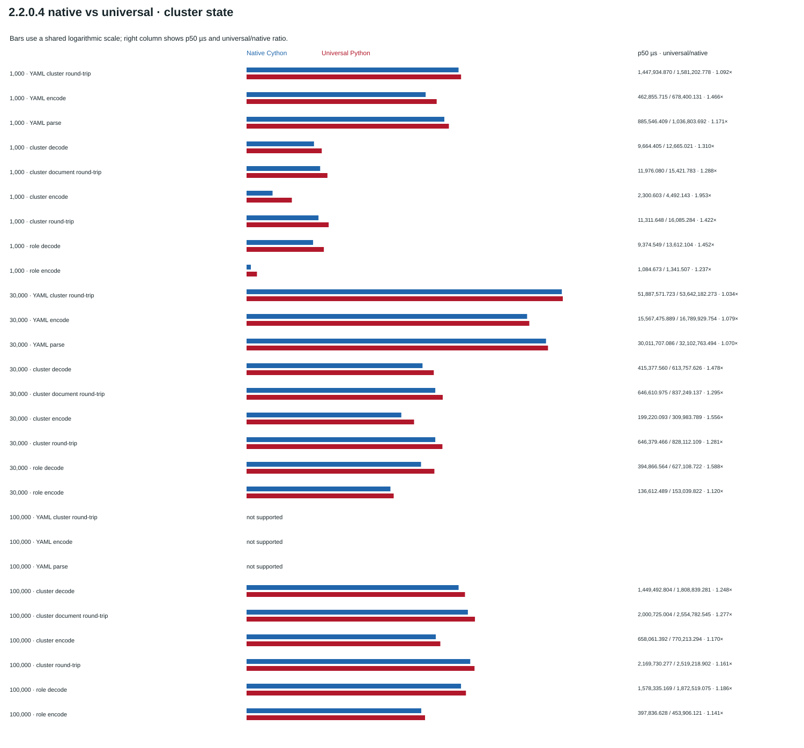
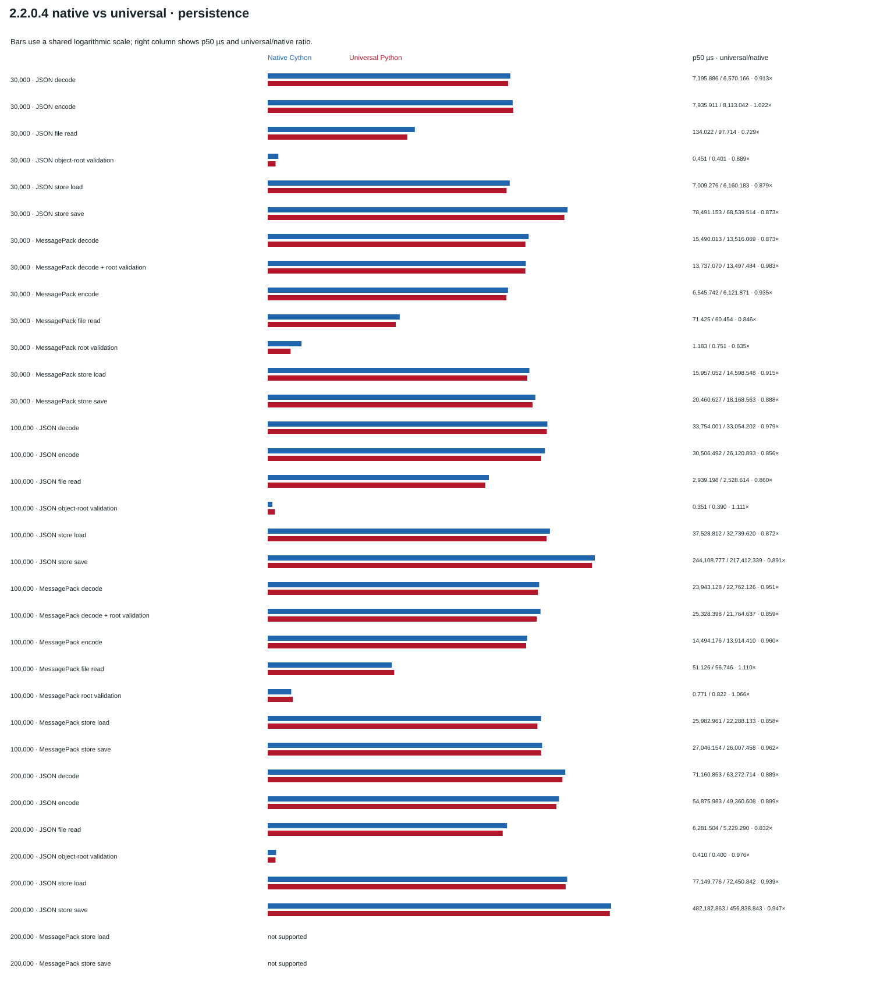
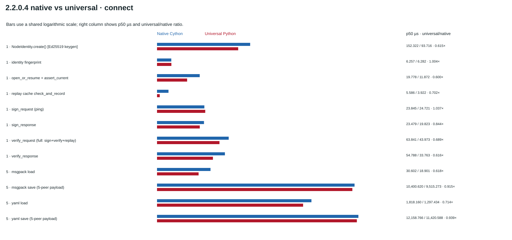

# Native and shared-harness performance baselines

**Historical measurements:** 18 October 2026<br>
**Runtime:** CPython 3.12.3, Linux x86_64, glibc 2.39<br>
**Packages:** 1.8.0.0, 1.9.0.1, 2.0.0.0, 2.0.0.2, 2.2.0.0, 2.2.0.1, and 2.2.0.3.

This page presents two distinct measurement sets. The historical diagrams
summarize the earlier standalone harnesses and retain their original recorded
values in the committed diagrams. Raw measurement source files are kept in the
local working tree for regeneration and are intentionally not published.
The shared-harness diagram summarizes new measurements made with one common
timing and reporting core, including separate 2.2.0.4 native and universal
columns alongside the earlier releases. The historical standalone diagrams and
the shared-harness diagram are not combined in a ratio series.

## Historical baseline

Historical full-workload runs use 30k, 100k, and 200k fixtures. The 30k
persistence fixture uses dictionary records; 100k and 200k persistence use
compact integer/boolean pairs. The 200k session registry was seeded directly
with equivalent active records, so those session rows measure lookup/resume,
not session creation. Historical focused persistence runs cover 30k/100k for
the six earlier versions. Their measurements and unavailable cases are shown
in the committed diagrams; the detailed source dataset remains local.

### Cross-version comparison

Cells show candidate p50 divided by the matching 1.8.0.0 p50 for the same
metric and fixture size, displayed to three significant figures. Below 1× is
faster; 0.7× means 30% lower. Hover over a cell for its exact p50 and ratio.


### Historical state scaling


### Historical operation latency


### Historical persistence

Historical full-workload persistence and the separate focused persistence
harness are shown in distinct panels. At 200k, MessagePack StateStore is
unsupported because of payload and array limits. Focused 2.2.0.3 persistence
at 30k/100k was not measured; these historical gaps are preserved.


## Shared-harness comparison

These new measurements use the shared timing, percentile, throughput, and JSON
result implementation. Cluster state uses 1,000 assignments and grants with
two warmups and nine samples. Connect workloads use ten warmups and fifty
samples; stateful operations remain unbatched. Persistence uses two warmups and
nine samples at 30k/100k for the six earlier versions and 200k JSON persistence
for all seven versions. Per-outcome fixture shapes, exact samples, imported
module paths, package versions, and support reasons are recorded in local raw
benchmark files used to regenerate the comparison diagram; those files are not
part of the published baseline.

Allocation tracking was disabled for these comparison runs, so `peak_bytes` is
null. The shared core's separate allocation pass is optional and is tested
independently from timed samples.

200k MessagePack StateStore operations are explicitly unsupported for every
version; no codec-only measurements substitute for them. Persistence at
30k/100k for 2.2.0.3 remains unmeasured. The 1.8.0.0 connect YAML StateStore
stages are unavailable because that API is not present. These new results are
not historical baseline measurements and make no source-attribution claim.


## 2.2.0.4 across-version and build comparisons

The shared-harness diagram above now includes both 2.2.0.4 builds next to all
earlier measured releases. Earlier releases have one recorded version column;
the 2.2.0.4 native Cython and universal Python builds are separate columns.
This uses the existing result files only; no historical wheel was rerun. Some
older cluster-state workloads used fewer warmups and repetitions than the
2.2.0.4 runs, so cross-version ratios are descriptive rather than a controlled
causal comparison. The historical standalone diagrams remain unchanged because
their harness and fixture definitions are not interchangeable with these runs.

## Same-version native vs universal build

The following is a separate comparison of the 2.2.0.4 Linux CPython 3.12 native
Cython wheel and `py3-none-any` universal wheel. The explicit patch bump was
requested for this checkout; package source files are unchanged from 2.2.0.3,
so the source change between versions is the version metadata only. The native
and universal artifacts retain their expected compiled-module versus Python
source difference. Only these two wheel types were measured; no historical
wheel was rerun. The raw run JSON is stored in
`docs/performance-build-comparison-results/` and is the source for these
diagrams. The results are not merged with either earlier measurement set.

### Cluster-state workloads



### Persistence workloads



### Connect workloads



Both wheels ran on CPython 3.12.3, Linux x86_64, glibc 2.39. The cluster-state
suite used sizes 1k/30k/100k, 2 warmups, 9 samples, and no allocation tracking;
the persistence suite used 30k/100k/200k with 2 warmups and 9 samples; connect
used 10 warmups and 50 samples (identity creation retains the harness's
10/200 configuration). All suites used batch count 1. Module paths and exact
samples are recorded in the raw results. The native wheel SHA-256 is
`ed1faf57de9c8b5f77aaf1d67bd077af47e0f0ef3b5835f2d41d59bb103c71f1`; the
universal wheel SHA-256 is
`2207230eb5731d20cd50b375734715c0e99376630bacf873ceebc9f0d27d75fe`.
The native suite triplet ran before the universal suite triplet. These are
descriptive paired results from one sequential pass, not an order-randomized or
repeated A/B study; cache, thermal, and time-order effects may influence the
ratios. In particular, do not treat them as causal Cython speedup claims.

Refresh or check only these three paired-build diagrams with:

```sh
.venv/bin/python -m scripts.update_performance_diagrams \
  --build-comparison-dir docs/performance-build-comparison-results
.venv/bin/python -m scripts.update_performance_diagrams --check \
  --build-comparison-dir docs/performance-build-comparison-results
```

## Interpretation and limitations

- The 2.2.0.1 wheel is the first in this comparison that includes
  `expra_connect.persistence` as a compiled Cython extension. Cythonizing the
  wrapper does not compile JSON, MessagePack, or filesystem operations.
- The 2.2.0.0-to-2.2.0.1 comparison is not a source-identical Cython A/B test:
  source changed, and the new release adds persistence to the compiled module
  set. Do not attribute timing differences solely to Cython.
- Save timings include filesystem synchronization and remain sensitive to
  filesystem/device state. Read timings are affected by cache state.
- Historical and shared-harness runs use different harnesses and fixture
  scales. They must not be used as one ratio series or treated as controlled
  before/after measurements.
- These representative workloads do not measure live network discovery,
  socket transport, TLS, concurrent load, or every public API.

## Refresh

The committed SVGs are embedded above. To rebuild them, the local historical
baseline dataset and shared-run JSON artifacts must be present in the working
tree; they are intentionally not tracked in Git:

```sh
.venv/bin/python -m scripts.update_performance_diagrams
.venv/bin/python -m scripts.update_performance_diagrams --check
```
