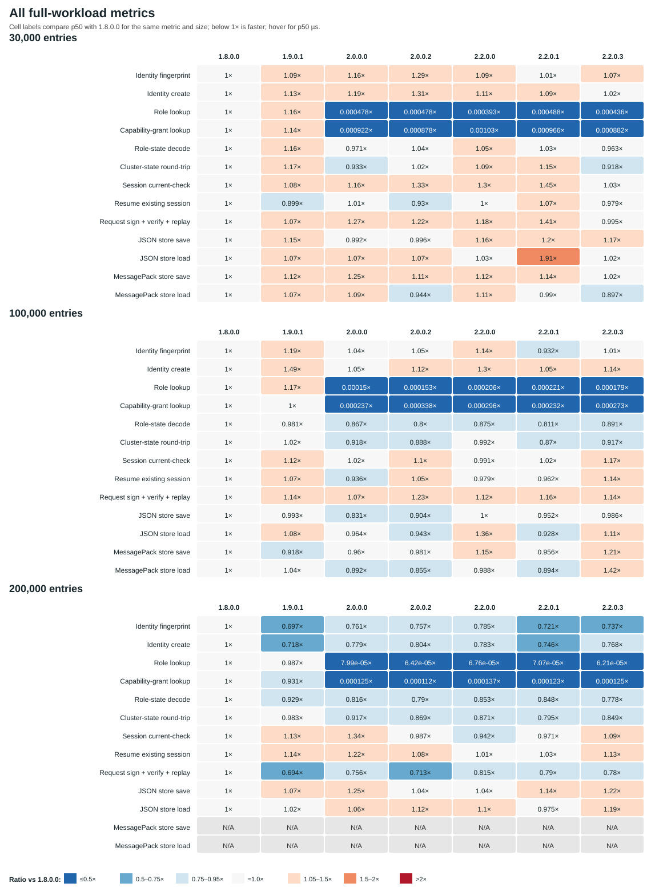
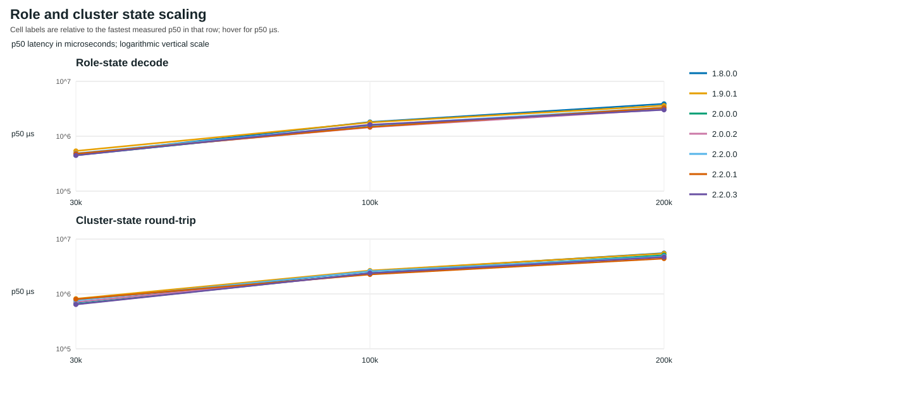
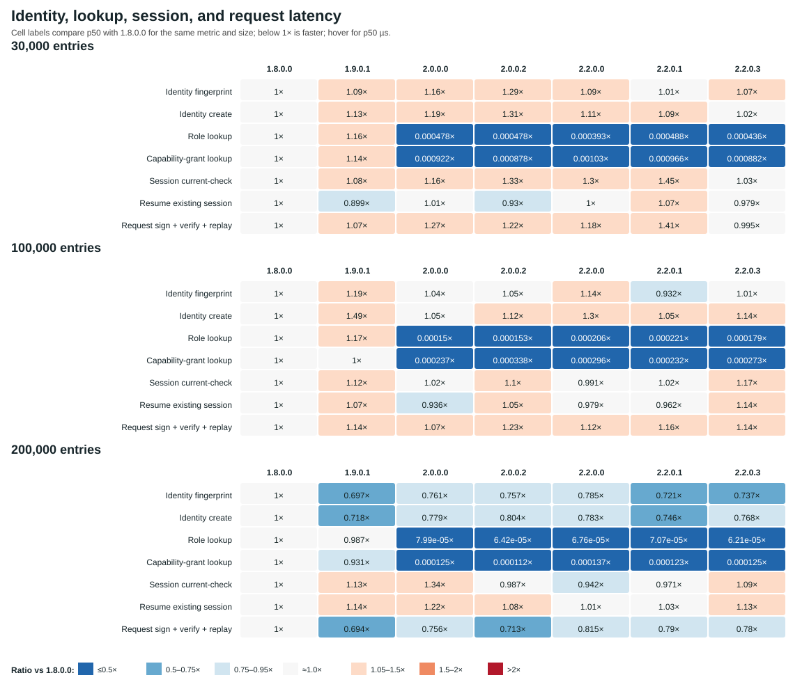
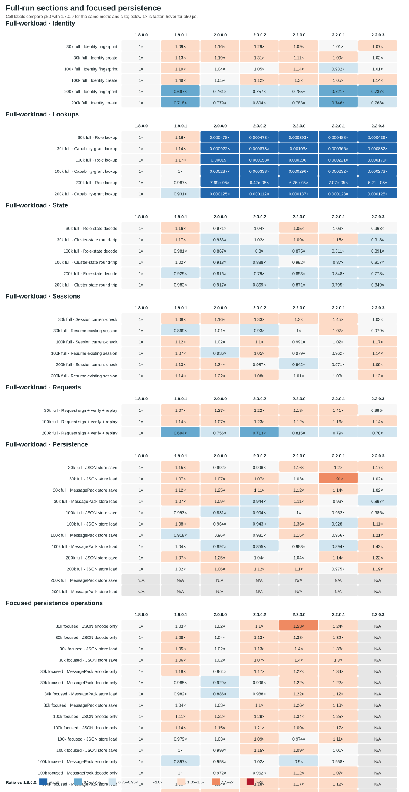
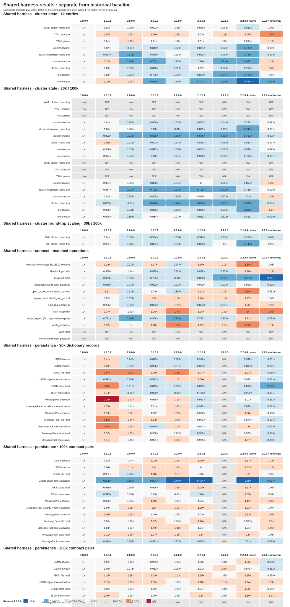

# Native and shared-harness performance baselines

**Historical measurements:** 18 October 2026<br>
**Runtime:** CPython 3.12.3, Linux x86_64, glibc 2.39<br>
**Packages:** 1.8.0.0, 1.9.0.1, 2.0.0.0, 2.0.0.2, 2.2.0.0, 2.2.0.1, and 2.2.0.3.

This page presents two distinct measurement sets. The historical diagrams
summarize the earlier standalone harnesses and retain their original recorded
values in [`performance-baseline-data.json`](performance-baseline-data.json).
The shared-harness diagram summarizes new measurements made with one common
timing and reporting core. The two sets are not combined in any ratio series.

## Historical baseline

Historical full-workload runs use 30k, 100k, and 200k fixtures. The 30k
persistence fixture uses dictionary records; 100k and 200k persistence use
compact integer/boolean pairs. The 200k session registry was seeded directly
with equivalent active records, so those session rows measure lookup/resume,
not session creation. Historical focused persistence runs cover 30k/100k for
the six earlier versions. Their exact saved measurements and unavailable
reasons remain unchanged in the canonical JSON dataset.

### Cross-version comparison

Cells show candidate p50 divided by the matching 1.8.0.0 p50 for the same
metric and fixture size, displayed to three significant figures. Below 1× is
faster; 0.7× means 30% lower. Hover over a cell for its exact p50 and ratio.



### Historical state scaling



### Historical operation latency



### Historical persistence

Historical full-workload persistence and the separate focused persistence
harness are shown in distinct panels. At 200k, MessagePack StateStore is
unsupported because of payload and array limits. Focused 2.2.0.3 persistence
at 30k/100k was not measured; these historical gaps are preserved.



## Shared-harness comparison

These new measurements use the shared timing, percentile, throughput, and JSON
result implementation. Cluster state uses 1,000 assignments and grants with
two warmups and nine samples. Connect workloads use ten warmups and fifty
samples; stateful operations remain unbatched. Persistence uses two warmups and
nine samples at 30k/100k for the six earlier versions and 200k JSON persistence
for all seven versions. Per-outcome fixture shapes, exact samples, imported
module paths, package versions, and support reasons are recorded in
[`tools/shared-benchmark-results/`](../tools/shared-benchmark-results/).

Allocation tracking was disabled for these comparison runs, so `peak_bytes` is
null. The shared core's separate allocation pass is optional and is tested
independently from timed samples.

200k MessagePack StateStore operations are explicitly unsupported for every
version; no codec-only measurements substitute for them. Persistence at
30k/100k for 2.2.0.3 remains unmeasured. The 1.8.0.0 connect YAML StateStore
stages are unavailable because that API is not present. These new results are
not historical baseline measurements and make no source-attribution claim.



## Interpretation and limitations

- The 2.2.0.1 wheel is the first in this comparison that includes
  `expra_connect.persistence` as a compiled Cython extension. Cythonizing the
  wrapper does not compile JSON, MessagePack, or filesystem operations.
- The 2.2.0.0-to-2.2.0.1 comparison is not a source-identical Cython A/B test:
  source changed, and the new release adds persistence to the compiled module
  set. Do not attribute timing differences solely to Cython.
- Save timings include filesystem synchronization and remain sensitive to
  filesystem/device state. Read timings are affected by cache state.
- Historical and shared-harness runs use different harnesses and fixture
  scales. They must not be used as one ratio series or treated as controlled
  before/after measurements.
- These representative workloads do not measure live network discovery,
  socket transport, TLS, concurrent load, or every public API.

## Refresh

Regenerate the historical diagrams from the canonical historical JSON and the
separate shared-run JSON artifacts with:

```sh
.venv/bin/python -m scripts.update_performance_diagrams
.venv/bin/python -m scripts.update_performance_diagrams --check
```
