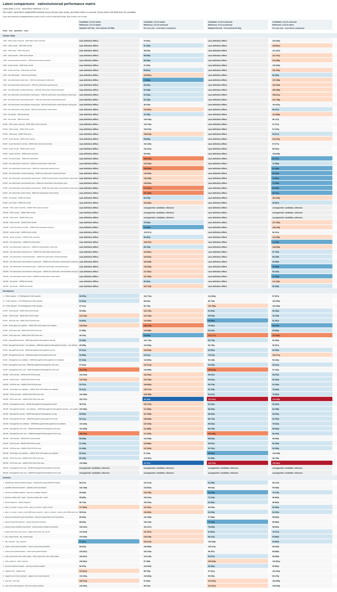

# Native and shared-harness performance baselines

- **Historical shared-harness measurements:** 18 October 2026
- **2.2.0.3 native/universal rerun:** 19 October 2026
- **2.2.1.0 native/universal full benchmark matrix:** 19 October 2026
- **2.2.1.0 supplemental feature workloads:** 20 October 2026
- **Runtime:** CPython 3.12.3, Linux x86_64, glibc 2.39
- **Compared results:** 1.8.0.0, 1.9.0.1, 2.0.0.0, 2.0.0.2, 2.2.0.0,
  2.2.0.1, 2.2.0.3 native/universal, 2.2.0.4 native/universal,
  2.2.0.5 native/universal, and 2.2.1.0 native/universal.

## What the diagram shows

- One consolidated comparison of historical releases and native/universal builds.
- Composite, cluster-state, persistence, and connect heatmaps.
- Weighted and full-workload indices, workload coverage, and four size-specific
  matched-workload plots.
- Ratios are relative to 1.8.0.0. Values below `1×` are faster; index values
  are unitless and lower is better.
- Results describe this benchmark mix. They are not predictions for every
  deployment workload.

## How scores and coverage work

- **Composite index:** geometric mean of matched p50 ratios. Cluster state,
  persistence, and connect receive equal suite weight; cases are equally
  weighted within each suite.
- **Weighted overall index (primary winner score):** geometric mean of matched
  p50 ratios, averaged within categories before applying these weights:
  - 1k cluster: 5%
  - 30k cluster: 15%
  - 100k cluster: 25%
  - Connect: 20%
  - 200k JSON persistence: 35%
- **Full-workload index:** equal-case geometric mean across the 37 positive-p50
  cases shared by every displayed result. It includes cluster state at 1k,
  30k, and 100k; matched connect cases; and 200k JSON persistence. It differs
  from the composite, which gives equal weight to the three suites.
- Only positive p50 results present in every compared column contribute to
  latency scores. Coverage is reported separately; missing cases receive no
  invented latency penalty.
- **Workload support / coverage:** the newest native/universal runs define the
  case inventory for each suite and size. Older results are measured against
  that inventory: new cases appear as unmeasured, and historical-only cases do
  not increase the denominator.
- Coverage includes cluster state at 1k, 30k, 100k, and 200k; connect; and
  persistence at 30k, 100k, and 200k. The cluster correctness matrix covers
  authorization decisions and state round trips at all four scales. Profile
  migration is reported separately by 1/16/64 files. Cluster round-trip scaling
  reuses cases and is not counted twice.
- The added deterministic feature slices are discovery (3 cases), pairing/trust
  (3), capability and surface authorization (3), cluster role authorization
-  (3), and profile migration (3). These measure in-process APIs, not live LAN
  discovery or network transport. Discovery, pairing, capability, and surface
  cases use Python source modules in both wheel flavors; role authorization and
  profile migration exercise modules compiled into the native wheel.
- YAML round trips remain capped at 30k; larger YAML sizes are unsupported and
  are not counted as correctness coverage. The scale-correctness tests use
  in-memory cluster serialization and hydration, not YAML.
- YAML size limits, unavailable connect operations, and the two unsupported
  200k MessagePack StateStore cases are explained in chart tooltips.

## Visible history window

- Keep at most 10 columns: the 1.8.0.0 baseline plus the newest results.
- Keep the baseline first/left and at the top of vertical plots. Order the
  remaining results chronologically, with the newest last/right/bottom.
- Use this same window for heatmaps, plots, summary winners, and index scores.
- When a new result exceeds the window, move the oldest non-baseline raw JSON
  into a sibling `history/` folder. Keep archived data, but exclude it from
  normal refreshes and current scoring.

<!-- performance-summary:start -->
- **Current weighted winner:** 2.2.1.0 native — 0.768 index; 37 matched positive-p50 cases.
  - Applies only to this workload set and weighting; it is not a universal claim.
- **Distinct-workload coverage:** 110 unique cases; reported separately from latency scoring.
  - 1.8.0.0: 63/110
  - 2.2.0.1: 65/110
  - 2.2.0.3 native: 69/110
  - 2.2.0.3 universal: 69/110
  - 2.2.0.4 native: 68/110
  - 2.2.0.4 universal: 68/110
  - 2.2.0.5 native: 69/110
  - 2.2.0.5 universal: 69/110
  - 2.2.1.0 native: 105/110
  - 2.2.1.0 universal: 105/110
  - Missing or unsupported cases receive no invented latency penalty.
<!-- performance-summary:end -->

## Diagram and size-specific plots


- The latest-build diagram below compares every matched case across the two
  newest complete native/universal versions. It shows candidate/reference p50s
  and ratios, is unweighted, and does not affect the weighted winner above.
- Each direction is shown explicitly: latest native against previous native and
  latest universal; latest universal against previous universal and latest
  native. Ratios below `1×` favor the candidate. Configuration differences are
  called out because they can limit version-to-version comparability.



- The composite uses cluster-state 1k and 30k/100k cases, connect cases, and
  200k JSON-persistence cases.
- 200k MessagePack StateStore is unsupported by payload/array limits.
- Focused 30k/100k persistence is excluded from the composite because it is not
  measured for every displayed release/build. Those results remain in the
  persistence heatmaps when available.
- Older releases have one column. 2.2.0.3, 2.2.0.4, 2.2.0.5, and 2.2.1.0
  have separate native and universal columns.
- Size plots normalize each workload's p50 against its matching 1.8.0.0 result,
  then calculate a geometric mean over cases measured in every displayed result.
  Current panels cover:
  - 9 cluster-state cases at 1k
  - 6 cluster-state cases at 30k
  - 6 cluster-state cases at 100k
  - 6 JSON-persistence cases at 200k
- Each size panel marks its **lowest observed index**. Panels are descriptive,
  not a universal ranking. Workload mixes differ by size, so points are not
  connected and do not represent one scaling curve.

## Refresh and source data

- The release workflow benchmarks the wheel artifacts for that build and
  refreshes the chart before artifact synchronization.
- A failed benchmark or chart refresh prevents artifact synchronization.
- Use `--skip-performance-benchmarks` for an intentional wheel-only build.
- Existing historical results are reused; prior wheels are not rebuilt or rerun.
- The 2.2.0.3 native and universal wheels were rerun as a matched full matrix on
  CPython 3.12.3. These results replace the former single 2.2.0.3 shared-harness
  records.
- The 2.2.1.0 native and universal wheels each completed the release benchmark
  matrix: cluster state (1k, 30k, 100k), persistence (30k, 100k, 200k), and
  connect. Each wheel has a saved JSON result for each suite under
  `docs/performance-build-comparison-results/2.2.1.0-<flavor>-*.json`. The
  configured limits leave the three 100k YAML cluster operations and two 200k
  MessagePack StateStore operations explicitly unavailable, not omitted runs.
- Separate append-only 2.2.1.0 native and universal supplement files add 15
  deterministic cases (9 connect, 3 cluster policy, and 3 profile migration)
  without rewriting the original suite JSON. Both wheel flavors were measured
  with CPython 3.12.3 on Linux x86_64/glibc 2.39 on 20 October 2026. The
  updater validates paired fixtures, runtime/configuration, and wheel-module
  provenance before merging supplements in memory.
- A numbered, paired cluster authorization shard adds 29 measured case IDs:
  eight authorization outcomes at 1k/30k/100k/200k while preserving the
  original coordinator-allow supplement IDs. It was run against the existing
  2.2.1.0 wheels on 20 October 2026 with one warmup, three repetitions, and
  allocation tracking disabled. The fixture correctness preflight passed at
  every scale. These timings are workload evidence, not a speedup claim.
- The resulting 2.2.1.0 coverage is 105/110 per flavor. Older builds are
  measured against the 110-case inventory; new cases remain unmeasured rather
  than receiving fabricated timings. Supplement shards remain separate files;
  the updater validates and merges them in memory.
- Versioned build JSON is stored in
  `docs/performance-build-comparison-results/`. Shared-harness JSON is tracked
  in `tools/shared-benchmark-results/` for reproducible refreshes.
- The shared harness records p50, fixture shape, module provenance, package
  version, and support reasons.

## Interpretation and limitations

- Older cluster-state runs used fewer warmups and repetitions than 2.2.0.4;
  cross-version ratios are descriptive, not controlled causal comparisons.
- Native suites ran before universal suites. Cache, thermal, and time-order
  effects may influence pairwise results.
- Allocation tracking was disabled; `peak_bytes` is null.
- Historical and shared-harness runs use different harnesses and fixture
  scales. Do not treat them as one ratio series or as controlled before/after
  measurements.
- The 2.2.0.1 wheel first includes `expra_connect.persistence` as a compiled
  Cython extension. Cythonizing the wrapper does not compile JSON, MessagePack,
  or filesystem operations.
- The 2.2.0.0-to-2.2.0.1 comparison is not a source-identical Cython A/B test:
  source changed, and 2.2.0.1 adds persistence to the compiled module set.
  Timing differences cannot be attributed solely to Cython.
- Save timings include filesystem synchronization and are device-sensitive;
  read timings are affected by cache state.
- These workloads do not cover live discovery, socket transport, TLS,
  concurrency, or every public API.

## Wheel artifacts

- Latest release: 2.2.1.0 (CPython 3.12 Linux x86_64 native and universal
  wheels). The native wheel compiles selected modules; the universal wheel uses
  Python source.
- Native wheel SHA-256:
  `df78b078a2c7434592b7cefda9aba2027d63c16f235c984eacbb8d4ee9666446`
- Universal wheel SHA-256:
  `72ef3ebc4bff3b1bbdd300aafffc64da80c549e76ed14bcad99bcbe19aee90df`

## Refresh commands

The committed SVG is embedded above. Refresh and verify it with:

```sh
.venv/bin/python -m scripts.benchmark_release_wheels --cluster-auth-shard \
  --version 2.2.1.0 --wheel-dir dist \
  --results-dir docs/performance-build-comparison-results \
  --python .venv/bin/python
.venv/bin/python -m scripts.update_performance_diagrams
.venv/bin/python -m scripts.update_performance_diagrams --check
```

The supplement command requires matched native and universal wheel artifacts.
It writes separate `*-supplement.json` files and refuses partial or existing
supplement sets rather than overwriting them.
